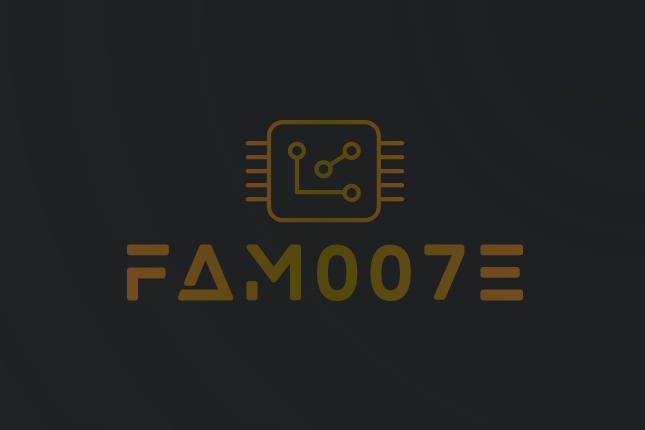

### Socials

 <a href="https://www.github.com/fam007e" target="_blank" rel="noreferrer"> <picture> <source media="(prefers-color-scheme: dark)" srcset="https://raw.githubusercontent.com/danielcranney/readme-generator/main/public/icons/socials/github-dark.svg" /> <source media="(prefers-color-scheme: light)" srcset="https://raw.githubusercontent.com/danielcranney/readme-generator/main/public/icons/socials/github.svg" />  </picture> </a> <a href="www.linkedin.com/in/fam007e" target="_blank" rel="noreferrer"> <picture> <source media="(prefers-color-scheme: dark)" srcset="https://raw.githubusercontent.com/danielcranney/readme-generator/main/public/icons/socials/linkedin-dark.svg" /> <source media="(prefers-color-scheme: light)" srcset="https://raw.githubusercontent.com/danielcranney/readme-generator/main/public/icons/socials/linkedin.svg" />  </picture> </a> <a href="https://www.youtube.com/@darkknightz007E" target="_blank" rel="noreferrer"> <picture> <source media="(prefers-color-scheme: dark)" srcset="https://raw.githubusercontent.com/danielcranney/readme-generator/main/public/icons/socials/youtube-dark.svg" /> <source media="(prefers-color-scheme: light)" srcset="https://raw.githubusercontent.com/danielcranney/readme-generator/main/public/icons/socials/youtube.svg" />  </picture> </a> <a href="https://www.twitch.tv/fam007e" target="_blank" rel="noreferrer"> <picture> <source media="(prefers-color-scheme: dark)" srcset="https://raw.githubusercontent.com/danielcranney/readme-generator/main/public/icons/socials/twitch-dark.svg" /> <source media="(prefers-color-scheme: light)" srcset="https://raw.githubusercontent.com/danielcranney/readme-generator/main/public/icons/socials/twitch.svg" />  </picture> </a>

### GitHub Stats

### 👷 Check out what I'm currently working on

- [fam007e/securepasswd_mgmt_apk](https://github.com/fam007e/securepasswd_mgmt_apk) - SecurePasswd MGMT for Android — Kotlin/Compose &#43; native C core. F-Droid friendly, reproducible builds. Mirror of the Codeberg repository.
- [fam007e/SecurePasswd_MGMT](https://github.com/fam007e/SecurePasswd_MGMT) - A secure, cross-platform password and TOTP manager with intuitive GUI and powerful CLI clients.
- [fam007e/narzo-50i-lineage](https://github.com/fam007e/narzo-50i-lineage) - Unlock, root &amp; install LineageOS 21 (Android 14) GSI on Realme Narzo 50i / C11 2021 (RMX3235/RMX3231, Unisoc SC9863A) — free, unbrickable, tested end-to-end on final firmware
- [fam007e/hold](https://github.com/fam007e/hold) - Track, manage, and apply pressure to **pending life events** where the user is waiting on another party (company, institution, person).   The app acts as an external memory &#43; escalation engine for “in-between” states.
- [fam007e/DWM](https://github.com/fam007e/DWM) - DWM personal configs
### 🌱 My latest projects

- [fam007e/securepasswd_mgmt_apk](https://github.com/fam007e/securepasswd_mgmt_apk) - SecurePasswd MGMT for Android — Kotlin/Compose &#43; native C core. F-Droid friendly, reproducible builds. Mirror of the Codeberg repository.
- [fam007e/narzo-50i-lineage](https://github.com/fam007e/narzo-50i-lineage) - Unlock, root &amp; install LineageOS 21 (Android 14) GSI on Realme Narzo 50i / C11 2021 (RMX3235/RMX3231, Unisoc SC9863A) — free, unbrickable, tested end-to-end on final firmware
- [fam007e/grub-theme-template](https://github.com/fam007e/grub-theme-template) - Configurable GRUB2 boot theme — swap fonts, background, colors, and menu layout via a single config file. No hand-editing theme.txt, no pre-baked .pf2 fonts required.
- [fam007e/receipts](https://github.com/fam007e/receipts) - You are what you do. Take `receipts`
- [fam007e/hold](https://github.com/fam007e/hold) - Track, manage, and apply pressure to **pending life events** where the user is waiting on another party (company, institution, person).   The app acts as an external memory &#43; escalation engine for “in-between” states.
### 🔨 My recent Pull Requests

- [fix(gui): read QSS template via QResource to close last code-scanning alert (#525)](https://github.com/fam007e/SecurePasswd_MGMT/pull/40) on [fam007e/SecurePasswd_MGMT](https://github.com/fam007e/SecurePasswd_MGMT)
- [chore(release): prep v2026.11.09](https://github.com/fam007e/securepasswd_mgmt_apk/pull/3) on [fam007e/securepasswd_mgmt_apk](https://github.com/fam007e/securepasswd_mgmt_apk)
- [chore(release): prep v2026.11.09](https://github.com/fam007e/SecurePasswd_MGMT/pull/39) on [fam007e/SecurePasswd_MGMT](https://github.com/fam007e/SecurePasswd_MGMT)
- [fix(gui): stop HealthCheckDialog HIBP worker from touching a destroyed dialog](https://github.com/fam007e/SecurePasswd_MGMT/pull/38) on [fam007e/SecurePasswd_MGMT](https://github.com/fam007e/SecurePasswd_MGMT)
- [fix(sync): guard sibling gpg-merge label comparisons against NULL](https://github.com/fam007e/securepasswd_mgmt_apk/pull/2) on [fam007e/securepasswd_mgmt_apk](https://github.com/fam007e/securepasswd_mgmt_apk)
### ⭐ Recent Stars

- [EUR-UN/metrics-community](https://github.com/EUR-UN/metrics-community) - Community maintained distribution of metrics with automated upstream sync pipeline and multi-source updates.
- [melqtx/tork](https://github.com/melqtx/tork) - cli for searching and downloading torrents
- [MicroTed/wrf4-elec](https://github.com/MicroTed/wrf4-elec) - Beta versions of WRF-ELEC (aka E-WRF) for WRF 4.6.1 / 4.5.1 / 4.3.1. see doc/README.electricity for details
- [ggml-org/llama.cpp](https://github.com/ggml-org/llama.cpp) - LLM inference in C/C&#43;&#43;
- [morluto/rea](https://github.com/morluto/rea) - Reverse engineer anything with agents, from app behavior down to native binaries.
### 📫 How to reach me:
  - Youtube   : <https://www.youtube.com/channel/UC0opCSTihsVYiv8QNIgQ4JA>
  - Twitch    : <https://www.twitch.tv/fam007e>
  - Mastodon  : <https://mastodon.social/@fam007e>
  - ORCiD     : <https://orcid.org/0000-0002-4969-8919>

<picture>
  <source media="(prefers-color-scheme: dark)" srcset="https://raw.githubusercontent.com/fam007e/fam007e/output/github-contribution-grid-snake-dark.svg">
  <source media="(prefers-color-scheme: light)" srcset="https://raw.githubusercontent.com/fam007e/fam007e/output/github-contribution-grid-snake.svg">
  
</picture>

---

### :hammer_and_wrench: Languages and Tools :

<table>
  <tr>
    <td></td>
    <td></td>
    <td></td>
    <td></td>
    <td></td>
    <td></td>
    <td></td>
    <td></td>
    <td></td>
    <td></td>
    <td></td>
    <td></td>
    <td></td>
  </tr>
</table>

